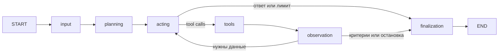

# ETL Diagnostic Agent

Учебный single-agent mini-product на **LangChain + LangGraph + LangSmith SDK**.
Принимает цель диагностики ETL, составляет план, вызывает инструменты, обновляет
рабочую память, проверяет критерии завершения и возвращает ответ с полным trace.
FastAPI предоставляет постоянную очередь задач, чтение результата, SSE и отмену;
DBOS и PostgreSQL обеспечивают сохранение и восстановление выполнения.

## Быстрый запуск

Нужны Docker с Compose v2, uv и Python 3.13. Команды выполняются из корня проекта.

```sh
cp .env.example .env  # только при первом запуске; существующий .env сохраняйте
make setup
```

В `.env` задайте `LLM_BASE_URL`, `LLM_MODEL`, `LLM_API_KEY`: нужна
OpenAI-совместимая модель с tool calling и structured outputs. Для DeepSeek можно
задать `LLM_EXTRA_BODY={"thinking":{"type":"disabled"}}`.

```sh
make up
curl --fail http://127.0.0.1:8123/ready
uv run --locked python examples/client.py 'Прочитай etl.log, затем calculator вычисли процент отклонённых строк.'
```

Готовность: `{"status":"ready"}`. Клиент печатает `task_id`, plan/action/tools/
observation/finalization, изменения state и итоговый JSON с `final_answer`,
`next_action`, `stop_reason`, памятью и `history`. Ожидаемый процент — **25%**.
Swagger: http://127.0.0.1:8123/docs. `make logs` — логи, `make down` — остановка
с сохранением данных. При другом `AGENT_PORT` передайте клиенту `--url`.

Альтернатива для разработки: `make infra`, затем `make run` (Python на хосте).
Перед переходом с Docker API выполните `make down`, затем `make infra`.
Два приложения с одной БД и стабильным DBOS executor_id одновременно не запускайте.
При изменении `POSTGRES_PORT` обновите порт в `TASK_DATABASE_URL` для запуска на хосте.

## Что умеет агент

| Tool | Вход | Результат и ограничения |
|---|---|---|
| `read_local_file` | `path` | UTF-8-файл внутри `TOOL_FILES_ROOT`, до 64 КиБ; `content`, `truncated` |
| `text_search` | `path`, `query` | Буквальный поиск с учётом регистра, до 50 строк с номерами |
| `calculator` | `expression` | Числа, скобки, `+ - * /`; конечное число, без исполнения Python |

Tools оформлены через LangChain `@tool` и Pydantic-схемы. По умолчанию доступны
учебные файлы `examples/tool_data`. Пути проверяются после разрешения symlink.
Ошибки tools становятся observations со `status=error`; остальные вызовы пакета
продолжают выполняться. [Контракты инструментов и настройки](docs/planning.md).

## Граф и состояние



Planning создаёт `ExecutionPlan` и `done_criteria`. Acting выбирает tool calls
по плану и текущей памяти. Tools сохраняет исходные результаты. Observation
обновляет память через LLM; код проверяет ссылки на evidence и ограничения.
Finalization формирует ответ, следующий шаг и объясняет причину остановки.

Центральная Pydantic-модель `AgentState` содержит цель, план, сообщения, историю,
`tool_results`, `observations`, `notes`, `done_criteria`, счётчики и итог.
Acting получает компактную память и последний полный обмен с tools; полная история
остаётся для аудита. Checkpoints LangGraph сохраняются в PostgreSQL после узлов;
DBOS хранит очередь, статусы и итоговый state. Память изолирована по `task_id`.

Остановка: `criteria_met`, `actor_finished`, `no_new_results`, `no_progress`
или `step_limit`. По умолчанию разрешено 5 успешных выполнений acting; число
вызовов tools в пакете может отличаться. Повторные одинаковые вызовы используют
кеш задачи, два пакета без нового успешного результата останавливают цикл.
LLM-узлы повторяют временные ошибки до трёх попыток по 30 секунд; общий дедлайн
задачи после получения из очереди — 180 секунд. [Подробности графа](docs/graph.md).

## Demo и полные traces

Пять задач с ожидаемыми результатами и командами: **[demo](docs/demo.md)**.
Машиночитаемые цели: [examples/goals.json](examples/goals.json).
Два полных реальных запуска: [артефакты и разбор](examples/traces/README.md).

API: `POST /tasks` → `202` с `task_id`; `GET /tasks/{task_id}` — статус/ответ;
`GET /tasks/{task_id}/events` — SSE с последовательностью завершённых узлов;
`POST /tasks/{task_id}/cancel` — отмена. Разрыв SSE не отменяет задачу.
Полный trace доступен в `result.history` и `result.messages` после завершения.
[Контракт API](docs/api.md).

## LangSmith и локальная наблюдаемость

LangSmith SDK подключён к LangGraph/LangChain; metadata связывает spans с
`task_id`, `thread_id`, `request_id`. Восстановление создаёт новый `run_id` того же
thread. В облаке доступны узлы, LLM, tools, ошибки, длительности и state updates.

```dotenv
LANGSMITH_TRACING=true
LANGSMITH_PROJECT=etl-agent
LANGSMITH_API_KEY=<ваш ключ>
LANGSMITH_ENDPOINT=https://api.smith.langchain.com
```

После изменения настроек перезапустите приложение. По умолчанию
`LANGSMITH_TRACING=false`: ключ и облачный сервис не нужны. Локальные SSE, history,
checkpoints и структурированные логи доступны всегда. Тесты проверяют настоящий
SDK через транспорт в памяти; это не подтверждение доставки в LangSmith.
В финальной локальной приёмке облако отключено по выбору пользователя.
[Трассировка, настройка и ошибки](docs/observability.md).

## Структура

```text
src/etl_agent/
  domain.py          # Pydantic: state, память, план и результаты
  infrastructure/    # LangGraph, planner LangChain, tools, DBOS adapter
  api.py, tasks.py    # FastAPI, контракт и сервис задач
  runtime.py         # жизненный цикл PostgreSQL/DBOS
  memory.py          # контекст, кеш, проверка evidence
  observability.py   # логи и LangSmith
  settings.py        # настройки окружения
  client.py          # клиент API/SSE
examples/            # клиент, пять целей, учебные данные, реальные traces
tests/              # unit, integration, e2e
docs/               # архитектура, API, demo и приёмка
```

## Проверки

```sh
make unit-test         # без ключей, Docker и сети
make integration-test  # настоящие LLM, PostgreSQL, FastAPI/DBOS
make e2e-test          # SSE, отмена, очередь, SIGKILL и восстановление
make test              # весь набор последовательно
make lint              # Ruff и mypy
make pre-commit
```

Integration/e2e используют отдельный Compose-проект `etl-agent-test`, volume и
порты 18123/15432. Нужны Docker и действующие LLM-настройки; отсутствие ключа
считается ошибкой, не skip. Эти наборы нельзя запускать одновременно.
[Тестирование](docs/testing.md), [отчёт дня 7](docs/acceptance.md).

## Scope и ограничения

Агент диагностирует предоставленные локальные ETL-данные и рекомендует следующий
шаг. Он не исправляет файлы, не запускает pipeline, не подключается к источникам
ETL, не ищет в интернете и не проверяет фактическое состояние внешних систем.
Он не является production multi-agent платформой; аутентификация, multi-tenant
изоляция и управление несколькими исполнителями не реализованы.

Качество плана и ответа зависит от LLM. Проверка evidence подтверждает связь с
результатом tool, но не доказывает правильность интерпретации моделью.
`status=success` означает успешное выполнение workflow: критерии могут остаться
невыполненными. Проверяйте `done_criteria`, `stop_reason` и ограничения ответа.
Кеш действует в пределах задачи; содержимое изменившегося файла не перечитывается
при тех же аргументах. История не ограничена как production-хранилище.

После аварии незаписанный узел и его read-only calls могут выполниться повторно.
Docker перезапускает API автоматически; при локальном запуске повторите `make run`.
Перед изменением графа завершите или отмените активные задачи.

[Вся документация](docs/README.md).
