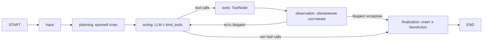

# Граф диагностики — agents_day03

`input` создаёт пользовательскую историю и HumanMessage. `planning` один раз
вызывает `Planner.create_plan(goal)` и сохраняет `ExecutionPlan.steps`. План
добавляется в messages и историю; этот узел не выполняет инструменты.

`acting` вызывает `Planner.act(messages)` с планом и всей перепиской, выбирает
инструменты или завершает диагностику. Только успешный ответ увеличивает
`current_step`. История acting содержит текст решения и все tool calls с именами,
аргументами и id, даже если модель не вернула поясняющий текст.

`tools` выполняет вызовы последовательно через ToolNode и сохраняет ToolMessage
в `pending_observations`, пока не меняя переписку и историю. `observation` без LLM
переносит результаты в messages и историю с исходным tool_call_id и status,
очищает pending_observations. Следующий actor получает все observations.
Неизвестный инструмент и ожидаемые ошибки возвращаются как ошибочный observation;
неожиданная ошибка реализации завершает задачу ошибкой.

`max_steps` ограничивает успешные вызовы acting, по умолчанию 5. Начальный план
и финализация в бюджет не входят. На последнем разрешённом шаге tools и observation
ещё выполняются, затем граф переходит к финализации с отметкой об исчерпании бюджета.
Если actor не выбрал инструментов, граф сразу переходит к финализации.

Финализация отдельно вызывает LLM со схемой FinalResponse: ответ и один
структурированный NextAction. Она получает все observations и план, но не может
вызвать инструменты.

Planning, acting и finalization используют RetryPolicy: max_attempts=3,
initial_interval=0.5, backoff_factor=2, max_interval=5, jitter=True.
Повторяются временные ошибки соединения, 429, 5xx и таймауты. Постоянные ошибки и
неверный результат не повторяются. SDK retries отключены. Успешные записи истории
и счётчик шагов не дублируются при retries.

Одна попытка LLM ограничена 30 секундами; input и observation — 5, tools — 10.
Общий дедлайн DBOS — 180 секунд. Лимит рекурсии учитывает три узла инструментальной
итерации. Отмена прерывает асинхронное выполнение; уже начатое чтение в потоке
может завершиться позже.

Checkpoints сохраняют план, messages, pending_observations, историю и следующий
узел. После сохранённого tools граф продолжает с observation без повторного вызова
инструментов. Если процесс погиб до сохранения tools, его read-only вызовы могут
повториться. Старые завершённые результаты читаются с новыми значениями по умолчанию;
активные checkpoints прежнего графа не мигрируются.

Trace в API и SSE: `plan → action → observation → next action`. SSE публикует
каждую запись истории с sequence начиная с 1, включая повторные узлы; пример
клиента печатает их по мере выполнения. Номер записи стабилен при восстановлении.
