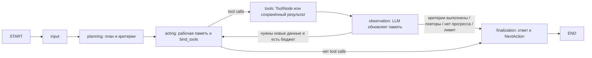

# Граф диагностики — день 5

`input` создаёт пользовательскую историю и HumanMessage. `planning` один раз
вызывает `Planner.create_plan(goal)` и сохраняет `ExecutionPlan.steps` и
`done_criteria`. Начальные критерии всегда невыполненные, без evidence.

`acting` получает цель, план, компактную рабочую память и последний полный обмен
AIMessage с tool calls / ToolMessage. Старые обмены остаются в архиве `messages`,
но не включаются в контекст LLM. Успешный ответ увеличивает `current_step`.

`tools` выполняет вызовы последовательно через ToolNode. Ключ кеша — имя и
канонический JSON аргументов, без tool_call_id. Повторы внутри пакета и между
шагами получают сохранённый результат, включая ошибки. У возвращённого ToolMessage
новый tool_call_id, а `additional_kwargs` содержит `result_id` и `reused`.
Изменение аргументов позволяет исправить ошибочный вызов. Кеш действует в одной
задаче; принудительного обновления одинакового вызова нет.

`tool_results` содержит исходные результаты с id вида `result_1`, именем,
аргументами и ToolMessage. `pending_observations` сохраняет ожидающий пакет.
Неизвестный инструмент, неверные аргументы и обычные исключения внутри tool
возвращаются со status=error. Неожиданное исключение подробно логируется,
а в ToolMessage записывается безопасное сообщение без внутренних данных.
Остальные вызовы пакета продолжаются; агент может исправить аргументы на следующем
шаге. Ошибки внедрённых через build_graph инструментов обрабатываются так же.
Отмена задачи не превращается в результат инструмента; таймаут узла сохраняет
существующее поведение ошибки.

`observation` вызывает `Planner.update_memory(MemoryInput)`. Модель получает
предыдущую выжимку, критерии и результаты текущего пакета, возвращает WorkingMemory:

| Поле | Ограничение |
|---|---|
| observations | до 10 наблюдений; summary до 500 символов; evidence — id результатов |
| notes | до 8 заметок по 400 символов: полезные факты, точные числа, открытые вопросы |
| done_criteria | до 5 критериев; description до 300 символов; satisfied и evidence |

Код проверяет размеры, неизменность формулировок и порядка критериев, существование
ссылок. Выполненный критерий обязан иметь evidence только из успешных результатов.
Семантическое соответствие evidence критерию оценивает LLM; проверка id не является
независимым доказательством правильности её вывода.
После успешной проверки observation атомарно обновляет память, переносит
ToolMessage в messages/историю и очищает pending_observations.

После observation граф завершает цикл, если выполнены все непустые критерии
(`criteria_met`), весь пакет повторяет сохранённые вызовы (`no_new_results`),
два пакета подряд не дали нового успешного результата (`no_progress`) или
исчерпан бюджет (`step_limit`), в таком порядке. Счётчик
`consecutive_no_progress` увеличивается только после успешной проверки памяти
в observation и сохраняется атомарно с ней; новый успешный результат обнуляет его.
Кешированный успех прогрессом не считается. Новые успешные вызовы с разными
аргументами считаются прогрессом даже при одинаковом содержимом результатов.
Порог — два пакета, без отдельной настройки API. Кеш обнаруживает также цикл
A → B → A: повторный A не исполняется и завершает граф по no_new_results.
Если условий остановки нет, граф возвращается к acting.
Пустой список критериев не означает успех. Actor также может завершить цикл
текстом без tool calls (`actor_finished`). Финализация получает компактный контекст,
не вызывает инструменты, объясняет причину остановки и перечисляет невыполненные
критерии. Ответ содержит final_answer и структурированный NextAction.

`max_steps` ограничивает успешные вызовы acting, по умолчанию 5. Планирование,
обновление памяти и финализация в бюджет не входят. Последний набор tools и
observation выполняется до финализации. Если acting получает уже исчерпанный
бюджет, он направляет граф в finalization без нового вызова LLM или tools.
Технический recursion_limit в worker равен max(25, max_steps * 3 + 5): он
оставляет место для всех циклов и финализации. При прямом вызове build_graph
с большим max_steps передавайте этот recursion_limit в RunnableConfig.
Planning, acting, observation и finalization
имеют RetryPolicy: 3 попытки, initial_interval=0.5, backoff_factor=2,
max_interval=5, jitter=True. Повторяются временные ошибки соединения, 429, 5xx и
таймауты; неверный результат и постоянные ошибки не повторяются. SDK retries
отключены. На попытку LLM отведено 30 секунд, input — 5, tools — 10. Общий дедлайн
DBOS остаётся 180 секунд и включает дополнительные вызовы обновления памяти.

PostgreSQL checkpoints сохраняют память, кеш, историю и следующий узел. После
сохранённого tools продолжается observation без повторного выполнения инструментов,
в том числе после ошибки обновления памяти. Если процесс погиб до сохранения tools,
его read-only вызовы могут повториться. DBOS сохраняет итоговый AgentState как JSON.
Отдельных таблиц результатов инструментов и общей памяти между задачами нет.

Каждый завершённый узел добавляет `state_delta` в свою последнюю запись истории.
Это изменённые значения памяти, счётчики, id новых/повторных результатов и причина
остановки, число новых успешных результатов (`new_successful_results` в tools)
и счётчик пакетов без прогресса (`consecutive_no_progress` в observation);
архивные messages/history и полные файлы в delta не копируются.
API/SSE передают delta, клиент печатает `state Δ` рядом с trace. Sequence нумерует
записи истории, а не узлы: у observation может быть несколько записей результатов,
но только последняя несёт delta всего шага.

Лог finalization содержит stop_reason, current_step и max_steps для любой причины
завершения, включая actor_finished. Причина передаётся модели финализации;
ограничения no_progress, no_new_results и step_limit явно добавляются к ответу.

Старые завершённые результаты читаются с пустыми новыми полями и state_delta=null;
отсутствующий consecutive_no_progress получает значение 0.
Активные checkpoints прежнего графа не мигрируются: перед обновлением завершите
или отмените старые активные задачи.

## Исправление невалидной рабочей памяти

Если `WorkingMemory` прошла Pydantic, но нарушает правила criteria/evidence,
observation передаёт модели `MemoryInput.validation_feedback` с причиной отказа
и отклонённым ответом. Разрешена ровно одна корректировка внутри текущей попытки
узла. Tools при этом не выполняются повторно. Исправленная память снова проходит
полный `validate_memory`; повторное нарушение завершает задачу ошибкой.
Общий timeout observation остаётся 30 секунд на попытку.

Evidence критериев может ссылаться только на успешные tool results, в том числе
для невыполненных критериев. Ошибка чтения остаётся в observations/notes;
невыполненный критерий чтения получает `satisfied=false`, `evidence=[]`.
Предупреждение `memory.validation_failed correction_attempt=1` показывает
корректировку в логах; оба вызова LLM видны в spans observation при LangSmith tracing.
