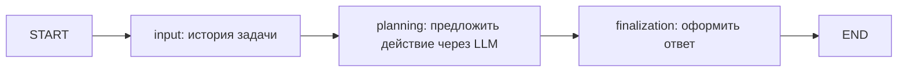

# Граф диагностики

`input` принимает `RunInput`, создаёт пользовательскую запись истории.
`planning` проверяет бюджет, вызывает `Planner.propose`, добавляет историю
и увеличивает current_step только после успешного ответа.
`finalization` использует NextAction, модель повторно не вызывает.

Planning использует RetryPolicy: max_attempts=3, initial_interval=0.5,
backoff_factor=2, max_interval=5, jitter=True. Повторяются только временные
ошибки (соединение, 429, 5xx, таймаут). Постоянные ошибки и неверный результат
не повторяются. SDK retries отключены.

TimeoutPolicy ограничивает отдельную попытку planning 30 секундами,
input и finalization — 5 секундами. Таймауты кооперативные; блокирующих
синхронных операций в узлах нет. Отмена не превращается в повтор провайдера.
Искусственные heartbeat и собственный watchdog не используются.
Ошибка после исчерпания повторов выходит из графа: DBOS runtime отмечает отказ.
