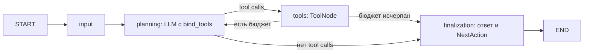

# Граф диагностики

`input` создаёт пользовательскую историю и HumanMessage. `planning` вызывает
`Planner.plan(messages)` и увеличивает `current_step` только после успешного ответа.
`tools` выполняет вызовы последовательно через ToolNode и сохраняет ToolMessage
с исходным `tool_call_id`. Следующий planning получает всю переписку и observations.
Неизвестный инструмент и ожидаемые ошибки возвращаются модели как ошибочный observation;
неожиданная ошибка реализации завершает задачу ошибкой.

`max_steps` ограничивает число успешных planning, по умолчанию 5. На последнем
разрешённом шаге tools ещё выполняются, затем граф переходит к финализации.
В таком случае ответ явно отмечает исчерпание бюджета. Финализация отдельно вызывает
LLM со схемой FinalResponse: ответ и один структурированный NextAction.
Она получает все observations, но не может вызвать инструменты.

Planning и finalization используют RetryPolicy: max_attempts=3,
initial_interval=0.5, backoff_factor=2, max_interval=5, jitter=True.
Повторяются только временные ошибки соединения, 429, 5xx и таймауты.
Постоянные ошибки и неверный результат не повторяются. SDK retries отключены.

Одна попытка planning/finalization ограничена 30 секундами, input — 5,
tools — 10. Общий дедлайн DBOS — 180 секунд. Файловые инструменты выполняются
LangChain в потоке и читают ограниченный объём данных. Отмена прерывает
асинхронное исполнение графа; уже начатое чтение в потоке может завершиться позже.

Checkpoints сохраняют сообщения, observations, историю и следующий узел.
После рестарта завершённый tools повторно не выполняется. Если процесс погиб
до сохранения узла tools, его read-only вызовы могут повториться.
Завершённые результаты старого графа читаются благодаря значениям по умолчанию
новых полей. Перед обновлением завершите или отмените старые активные задачи:
миграция незавершённых checkpoints предыдущего графа не предусмотрена.
