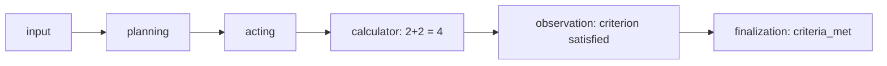
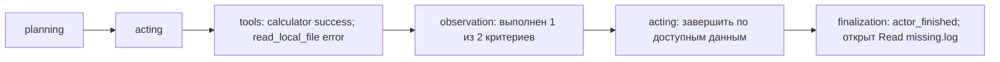
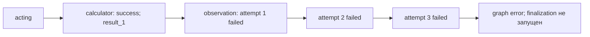

# Логи и трассировка

make logs показывает общий процесс FastAPI/DBOS и PostgreSQL. make run запускает Python-приложение
локально и выводит его логи прямо в терминал. FastAPI пишет X-Request-ID, HTTP-статус и длительность запроса.
Создание задачи и сообщения графа содержат task_id; граф также пишет узел, номер
попытки и длительность вызова LLM. Идентификатор запроса передаётся через очередь
в metadata графа. Тексты задач, ключи, DSN и upstream HTTP-ответы маскируются
в диагностике приложения; цепочка исключений и traceback сохраняются.

Статус и безопасная ошибка читаются через GET /tasks/{task_id}. Для фоновой ошибки
первоначальный POST уже мог вернуть 202; результат определяется статусом задачи.

LangSmith не нужен для запуска. Он включается явно через Settings, независимо от
автоматического обнаружения переменных библиотеками. См. [настройку дня 6](#день-6).
Доставка в облако проверяется отдельно; при включении содержимое запросов/ответов
может передаваться во внешний сервис.

При контейнерном запуске после SIGKILL Docker перезапускает общий процесс приложения, DBOS возвращает незавершённое исполнение
в очередь, а LangGraph продолжает с checkpoint. E2E проверяет факт аварии и
восстановление того же task_id. Само наличие checkpoints доказательством не является.

При локальном запуске после аварии нужно повторить make run; восстановление
задач из PostgreSQL выполняется DBOS при старте.

Инструменты пишут `tool.started`, `tool.completed` и `tool.failed` с именем,
tool_call_id и корреляционными идентификаторами задачи. Начало содержит аргументы,
завершение — status, elapsed_ms и результат. Аргументы и результат ограничены
1024 символами; известные секреты маскируются общим formatter. Эти записи могут
содержать фрагменты ETL-файлов. Полный observation хранится в checkpoint и результате.


Trace дня 4 хранится в result.history и передаётся через SSE: planning — краткий
план, acting — решение с именами/аргументами/id инструментов, observation —
ToolMessage с результатом, status и tool_call_id. Последующий acting получает компактную память и последний полный цикл инструментов. Клиент examples/client.py печатает trace по мере выполнения.
SSE sequence различает повторные узлы и позволяет убрать повторы при переподключении.

После каждого узла state_delta показывает изменения рабочей памяти, счётчики,
новые/повторные result_id и причину остановки. Tools пишет отдельную запись истории,
а событие `tool.reused` в логах показывает использование сохранённого результата.
Observation завершает свой trace только после успешного обновления и проверки
памяти; временный сбой повторяет этот узел, не инструменты. Полные данные state
передаются через API/checkpoints, а не дублируются в диагностических логах.


## День 6

### Подключение LangSmith

По умолчанию `LANGSMITH_TRACING=false`: клиент не создаётся, отправка traces
отключена контекстом SDK даже при наличии ключа. История, SSE и логи работают всегда.
Для облака настройте `.env` и перезапустите приложение:

```dotenv
LANGSMITH_TRACING=true
LANGSMITH_PROJECT=etl-agent
LANGSMITH_API_KEY=<ключ вашего проекта>
LANGSMITH_ENDPOINT=https://api.smith.langchain.com
```

Для EU-проекта используйте `https://eu.api.smith.langchain.com`.
При включённой трассировке пустой ключ, placeholder и пустой проект отклоняются
до запуска DBOS. Клиент получает endpoint и ключ из Settings; `tracing_context`
передаёт проект и клиент вложенным LangGraph/LangChain вызовам без изменения os.environ.
Используется SDK LangSmith >=0.14.11 с ограничением ожидания `Client.close(timeout=2)`.

Корневой span называется `etl-agent`, внутри видны узлы, LLM и фактические tools.
Metadata содержит `task_id`, `thread_id=task_id` и первоначальный `request_id`.
Каждое исполнение графа получает новый `run_id`; восстановление из checkpoint
образует новый trace в том же thread. Кешированный tool не имеет нового tool span:
его использование видно в `tool.reused` и state delta узла tools.

Ошибка создания клиента выключает внешнюю трассировку для исполнения и даёт
`tracing.unavailable`. Ошибки доставки/закрытия дают `tracing.delivery_failed` /
`tracing.flush_failed` и не меняют результат задачи. Доставка best effort:
успешная задача не доказывает, что trace появился в облаке. При аварийном завершении
буфер может потеряться; после восстановления будут видны spans нового исполнения.

**Облачные traces могут содержать goal, prompts, ответы, содержимое файлов и полное
состояние. Маскирование локальных логов не маскирует inputs/outputs LangSmith.**
Включайте отправку для данных, которые разрешено передавать в выбранный проект.

Ручная проверка доставки (не входит в offline-проверки):

1. Включите настройки выше и выполните `make run` или `make up`.
2. Запустите `uv run --locked python examples/client.py 'Вычисли 2+2'` и сохраните task_id.
3. В LangSmith откройте проект и найдите trace по metadata.task_id; проверьте thread
   с тем же идентификатором, корень `etl-agent`, вложенные acting/tools/observation.
4. Сопоставьте tool_call_id в output acting, ToolMessage и history; проверьте
   state_delta observation и причину финализации. Отсутствие `tracing.*failed`
   само по себе не подтверждает доставку — проверьте наличие trace в интерфейсе.

### Как читать выполнение

| Событие | Что показывает |
|---|---|
| `node.started` | Узел и номер попытки |
| `action.chosen` | Выбор tools или завершения; ограниченные аргументы вызовов |
| `node.chosen` | Следующий узел и причина условного перехода |
| `tool.started` / `tool.completed` | Имя, tool_call_id, аргументы, status, время и результат |
| `observation.received` | Связь tool_call_id → result_id и status до обновления памяти |
| `tool.reused` | Повторный вызов связан с прежним result_id |
| `state.updated` | Краткая delta: шаг, результаты, счётчики памяти и критериев, stop_reason |
| `node.completed` | Успешное завершение попытки с длительностью |
| `node.failed` | Ошибка попытки с traceback и длительностью |
| `node.cancelled` / `node.interrupted` | Отмена или штатный interrupt графа |
| `diagnosis.completed` | Причина остановки и использованный бюджет |

Каждый узел, включая input, tools и finalization, пишет lifecycle-события.
Корреляционные поля задаются контекстом исполнения и изолированы между задачами.
`state.updated` описывает успешно вычисленное обновление; подтверждение его
сохранения — checkpoint. После SIGKILL последнее событие лога могло не сохраниться
в checkpoint, поэтому узел может быть выполнен заново.

Краткие логи не дублируют полный state: новые observations и evidence доступны
в history/SSE, checkpoints и output узла в LangSmith. `state.updated` содержит
количество observations, notes и выполненных критериев, а не их свободный текст.
При ошибке до завершения observation исходный ToolMessage уже сохранён после tools,
хотя в history ещё нет завершённого observation. Для разбора используйте checkpoint,
логи `tool.completed` и spans tools. SSE содержит только завершённые узлы и итоговый
статус задачи; отдельные неуспешные попытки видны в логах и spans.

### Три разобранных сценария

Сценарии в `tests/unit/test_tracing.py` используют внедрённый planner, настоящие
локальные tools и SDK LangSmith с транспортом в памяти. SDK формирует реальные
POST/PATCH traces, но транспорт не выходит в сеть. Тесты проверяют корневой проект,
идентификаторы, родительские связи, tool spans, ошибки, логи и состояние.
Это подтверждает формирование traces, но не доставку в облако и не качество
решений настоящей LLM.

```sh
make test TEST_PATH=tests/unit/test_tracing.py
```

#### 1. Успешный

Цель: вычислить `2+2`. Один критерий: `Calculate 2+2`.



Acting выбирает call `calc`; tools возвращает success и `result_1`.
Observation сохраняет `2+2=4`, evidence=`result_1`, отмечает критерий выполненным.
В delta видны один observation и один выполненный критерий; переход к finalization
имеет `stop_reason=criteria_met`. Все spans завершаются без ошибки.
Следовательно, остановка подтверждена результатом инструмента.

#### 2. Частично успешный

Цель: вычислить `2+2` и прочитать отсутствующий `missing.log`.



Пакет содержит `calc` → `result_1` со status=success и `read` → `result_2`
со status=error. Ошибка чтения остаётся данными ToolMessage и не прерывает пакет.
Память подтверждает только расчёт. Второй acting завершает диагностику;
финальный ответ содержит `Не подтверждено: Read missing.log`.
Задача технически завершается успешно, но цель выполнена частично: status задачи
и зелёный корень trace нельзя приравнивать к выполнению всех критериев.
Проверяйте status каждого ToolMessage и оставшиеся done_criteria.

#### 3. Ошибочный

Цель: вычислить `2+2`; после успешного инструмента провайдер обновления памяти
трижды возвращает временную ошибку.



В логах ровно один `tool.started name=calculator` и три `node.failed node=observation`
с attempt=1/2/3. У observation нет `node.completed`; в trace есть error,
а в checkpoint — успешный tool result и ещё не обновлённая память.
Сбой произошёл при обновлении памяти, а не при расчёте. Отдельный тест восстановления
после tools подтверждает новый корень trace в прежнем thread без повторного tool.

### Основные failure modes

| Failure mode | Признак и вывод |
|---|---|
| Ошибка аргументов, неизвестный tool, отсутствующий файл | ToolMessage status=error; проверить acting args и результат конкретного tool_call_id |
| Частичный успех пакета | Смешанные statuses и открытые criteria; технический success задачи не означает полного достижения цели |
| Повтор A → B → A | `tool.reused`, прежний result_id, ноль новых результатов; `no_new_results` останавливает цикл |
| Разные ошибочные вызовы без прогресса | Растёт consecutive_no_progress; после двух пакетов — `no_progress` |
| Слишком длинная диагностика | current_step достигает max_steps, `step_limit`; это ограничение, а не исключение |
| Некорректный ответ LLM или evidence памяти | `node.failed` соответствующего узла; отсутствует успешная state delta этой попытки |
| Временная ошибка провайдера / таймаут узла | Повторный `node.started` с растущим attempt; после исчерпания попыток — ошибка задачи |
| Отмена / общий дедлайн | `node.cancelled` активного узла; конечный API status interrupted/timeout показывает причину задачи |
| Штатный interrupt | `node.interrupted`; не считать ошибкой инструмента, см. pending checkpoint |
| Падение процесса | Нет финальных событий; новый run_id того же task_id после восстановления; незаписанный узел мог повториться |
| Недоступен LangSmith | `tracing.*` / предупреждения SDK, при этом локальные логи, history и checkpoints доступны |

Общий дедлайн и пользовательская отмена могут выглядеть одинаково внутри узла;
различайте их по конечному статусу задачи в API. Ошибка tools, возвращённая как
ToolMessage, может иметь успешный span вызова: для диагностики проверяйте и output.status.
